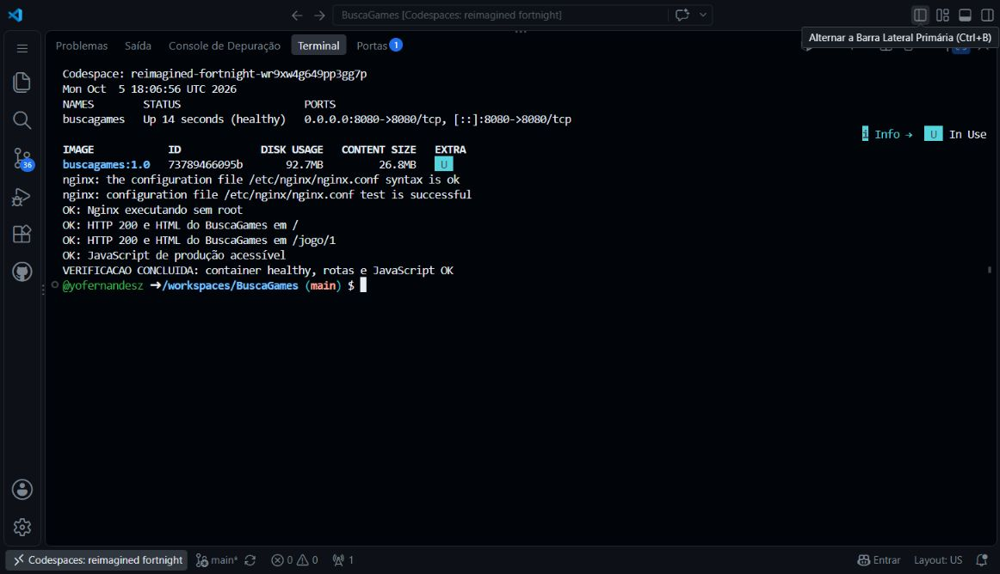

# Atividade: imagem Docker eficiente do BuscaGames

> Atualização do catálogo: as evidências abaixo documentam a versão estática anterior.
> A versão atual usa também uma API Node e volume SQLite. Para executar o sistema completo,
> configure `.env` e use `docker compose up -d --build --wait`, conforme [Backend](../backend/README.md).
> Executar apenas a imagem Nginx não inicia a sincronização.

## Evidência real de execução — 05/10/2026

A imagem `buscagames:1.0` foi construída e executada no GitHub Codespaces
`reimagined-fortnight-wr9xw4g649pp3gg7p`. A verificação confirmou:

- Container `healthy`, com a porta `8080:8080` publicada.
- Configuração do Nginx válida e processo executando sem root.
- HTTP 200 com HTML do BuscaGames em `/` e `/jogo/1`.
- JavaScript de produção acessível.
- Busca por `GTA VI`, navegação para `/jogo/2` e recarregamento dessa rota
  funcionando no navegador pela porta privada do Codespaces.
- `docker image ls` mostrou **92,7 MB em DISK USAGE** e **26,8 MB em
  CONTENT SIZE**, para o ID `73789466095b`. São as duas métricas exibidas
  pelo Docker 29 nesse ambiente, não uma comparação com uma imagem anterior.

Print principal para colar no campo da atividade:



Evidências complementares: [build concluído](../evidencias/docker/docker-build-codespaces.jpg)
e [aplicação no navegador](../evidencias/docker/buscagames-container.jpg).

Os arquivos foram transferidos da versão local para o Codespace; não foi
feito commit ou push no GitHub. O pacote de código e o logo foram conferidos
por SHA-256 antes do build.

Após a validação e a captura dos prints, o container e o Codespace foram
parados. Os arquivos permanecem salvos. Para repetir a demonstração, reabra
o Codespace e execute `docker start buscagames`.

## Aplicação utilizada

O BuscaGames é um catálogo de jogos em React e Vite, com busca, cadastro,
avaliação e páginas de detalhes. Nesta versão, os dados ficam em memória no
navegador; não existe servidor de API ou banco de dados. O container serve o
frontend compilado na porta 8080.

## Arquivos da entrega

- `Dockerfile`: construção em duas etapas, com comentários.
- `.dockerignore`: limita os arquivos enviados ao Docker.
- `nginx.conf`: servidor HTTP e suporte às rotas do React.
- Este documento: execução, verificação e explicação das otimizações.

## Construir e executar no GitHub Codespaces

1. Abra o repositório no GitHub e use **Code → Codespaces** para abrir um
   Codespace existente ou criar um. Os arquivos desta entrega e a pasta
   `frontend/` atualizada precisam estar nesse ambiente. Alterações feitas
   apenas no computador local não aparecem automaticamente no Codespace.
2. No terminal Bash do Codespaces, vá à raiz do projeto, onde está o Dockerfile.
3. Execute:

```bash
docker build --pull -t buscagames:1.0 .
docker run -d --name buscagames -p 8080:8080 buscagames:1.0
```

Se já existir um container chamado `buscagames` de uma tentativa anterior,
use outro nome ou remova apenas esse container de teste com
`docker rm -f buscagames` antes de repetir o comando.

## Verificar e produzir a evidência

Cole este bloco no terminal Bash do Codespaces. Ele para em caso de falha e
só imprime a confirmação final quando todas as verificações passam:

```bash
(
  set -eu
  echo "Codespace: ${CODESPACE_NAME:?Execute este bloco no GitHub Codespaces}"
  date -u
  for tentativa in $(seq 1 30); do
    estado=$(docker inspect --format '{{.State.Health.Status}}' buscagames)
    [ "$estado" = healthy ] && break
    sleep 1
  done
  test "$estado" = healthy
  docker ps --filter name=^/buscagames$ --format 'table {{.Names}}\t{{.Status}}\t{{.Ports}}'
  docker image ls buscagames:1.0
  docker exec buscagames nginx -t
  test "$(docker exec buscagames id -u)" != 0
  echo 'OK: Nginx executando sem root'
  for rota in / /jogo/1; do
    html=$(curl --fail --silent --show-error "http://localhost:8080$rota")
    printf '%s' "$html" | grep -q 'BuscaGames'
    echo "OK: HTTP 200 e HTML do BuscaGames em $rota"
  done
  asset=$(printf '%s' "$html" | grep -oE '/assets/[^" ]+\.js' | head -n 1)
  test -n "$asset"
  curl --fail --silent --show-error -o /dev/null "http://localhost:8080$asset"
  echo 'OK: JavaScript de produção acessível'
  echo 'VERIFICACAO CONCLUIDA: container healthy, rotas e JavaScript OK'
)
```

Na aba **Ports**, abra a porta **8080** no navegador. Confira o catálogo,
pesquise um jogo, abra seus detalhes e atualize a página nessa rota. Isso
complementa os testes HTTP com a verificação da interface React.

Capture um print real do terminal mostrando o ambiente do Codespaces, o
container `healthy`, a porta publicada, o tamanho da imagem e os resultados
das verificações. No campo de resposta da atividade, cole a imagem com
**Ctrl+V**. Se necessário, use dois prints para manter o texto legível.

Não use os exemplos deste documento como se fossem uma saída real de execução.
O tamanho da imagem deve ser o valor medido por `docker image ls`.

Após registrar a evidência, pare o container com `docker stop buscagames` e
pare o Codespace pelo menu do GitHub quando terminar de usá-lo.

## Explicação das escolhas de otimização

1. **Multi-stage build:** a primeira etapa usa Node.js 24 para instalar as
   dependências e compilar o React. A segunda recebe somente `dist/`. Assim,
   Node, npm, dependências de desenvolvimento e fontes não compõem a imagem
   final. A separação reduz o conteúdo necessário para executar a aplicação.
2. **Base Alpine:** usa uma distribuição enxuta tanto no build quanto no
   servidor final. Nginx serve o resultado estático sem precisar executar o
   servidor de desenvolvimento do Vite.
3. **Cache de dependências:** os manifestos são copiados antes do código.
   Mudanças apenas na interface não invalidam a camada de instalação. O cache
   BuildKit em `/root/.npm` reaproveita downloads quando a instalação precisa
   ser refeita, sem incorporar esse cache à imagem final.
4. **Instalação pelo lockfile:** `npm ci` usa as versões registradas em
   `package-lock.json` e detecta divergências com `package.json`. As bases
   `node:24-alpine` e `stable-alpine` recebem atualizações; portanto, o lockfile
   fixa as dependências npm, mas não torna toda a imagem imutável. Para exigir
   a mesma base em todas as construções, seria necessário fixar seus digests.
5. **Contexto de build restrito:** `.dockerignore` envia apenas o frontend e
   as configurações necessárias, excluindo `node_modules`, builds locais,
   arquivos de ambiente. Os testes entram na etapa de build para o Compose
   de CI; a imagem final continua contendo apenas `dist/`. Isso evita transferências desnecessárias e
   a cópia de dependências do Windows para o Linux.
6. **Execução sem root:** a variante Nginx Unprivileged já oferece a estrutura
   necessária para executar com usuário sem privilégios na porta 8080.
   Essa escolha melhora a segurança da execução.
7. **Cache HTTP:** arquivos em `/assets/` têm nomes com hash e cache longo;
   o HTML é revalidado para encontrar os arquivos de uma nova versão.
8. **Healthcheck leve:** usa o `wget` já disponível na base para verificar o
   servidor HTTP, dispensando a instalação de outra ferramenta. A navegação
   manual verifica a interface, que o healthcheck sozinho não cobre.

Referências: [boas práticas do Docker](https://docs.docker.com/build/building/best-practices/),
[cache do BuildKit](https://docs.docker.com/build/cache/optimize/) e
[Nginx Unprivileged](https://github.com/nginx/docker-nginx-unprivileged).
